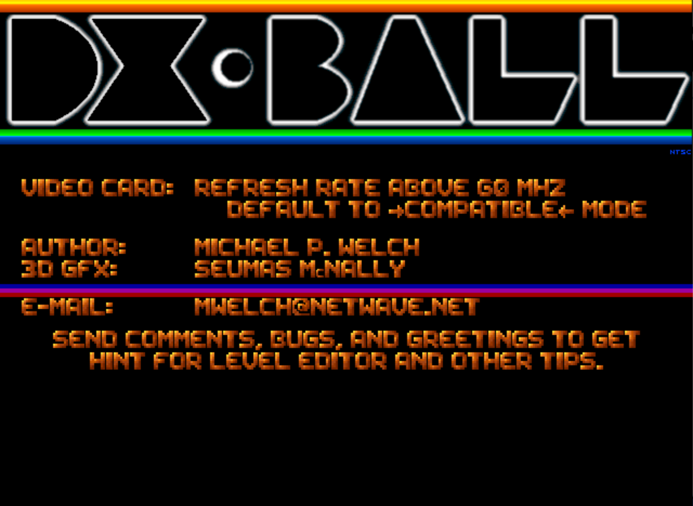
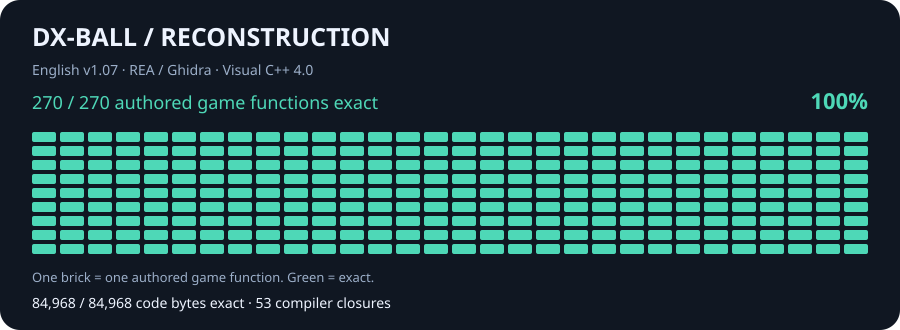

# DX-Ball reconstruction

This project reconstructs English DX-Ball v1.07 as readable C/C++ using the
original executable and resources. Codex uses [REA](https://github.com/morluto/rea)
to inspect the program through Ghidra, recover its functions, and compare code
compiled with Visual C++ 4.0 against the original.

<p align="center">
  <a href="https://www.youtube.com/watch?v=TzRGCIkp_c4"><strong>▶ Watch the Windows build &amp; gameplay demo</strong></a><br>
  <sub>6:20 · Compilation at 4× speed · Gameplay at normal speed</sub>
</p>

<p align="center">
  <a href="https://www.youtube.com/watch?v=TzRGCIkp_c4">
    
  </a>
</p>

<details>
<summary>Original DX-Ball title screen</summary>

<p align="center">
  
</p>

</details>

## Progress

All **270/270 authored game functions** and **84,968/84,968 authored code bytes**
are exact. Source recovery completed on October 22, 2026; the October 31 update
adds native Windows build verification and windowed play results. The game
builds from the reconstructed C/C++ with the original VC4 compiler.

<p align="center">
  
</p>

The current game has these recorded results:

| Check | Result |
| --- | --- |
| Basic play and editor | Paddle movement, ball release, pause/resume, painting, complete save/reload and normal exit pass. |
| Game-over and rankings | Three natural life losses, name editing and complete ranking persistence through restart pass. |
| Fifty-board terminal fixture | 50 editor-created single-brick boards, 50 real clears, final routing/storage and normal exit pass. |
| Original-bank continuous play | A 15-minute episode reaches the third original board, with no crash. |
| Digital audio | The game produces a verified stereo signal. |
| Windowed Wine play | cnc-ddraw passes play/editor and 960×720 game-over, ranking save/reload and restart checks. |
| Native Windows build | All 141 source units compile; all 270 authored functions still match. The linked image differs from the tested build only in build timestamps. |
| Windows 11 manual play | The user reports no major playability problem with the windowed compatibility profile. |

Remaining validation:

- Complete the original 50-board campaign and exercise every power-up in live play.
- Resolve exclusive-mode focus/surface recovery under Wine/Xvfb. The windowed wrapper uses different activation behavior.
- Complete native graphics/audio/MIDI and frame-pacing coverage. Manual feedback is scoped separately from automated checks.

See [progress](docs/PROGRESS.md), the [build record](docs/research/CURRENT_VC4_BUILD.md)
and [playability results](docs/research/PLAYABILITY_20261031.md) for counts and evidence.

## Reconstruction with REA

1. Inspect a function's instructions, pseudocode, calls and data references.
2. Recover its logic in typed C/C++ and connect it to the game.
3. Compile with VC4 and compare the complete function, then use remaining
   differences to refine types, state writes, control flow and source layout.

Comparisons map relocated calls and data references to their original addresses
and include literals and attached metadata. The
[projectile-list example](docs/REA.md) follows one routine from analysis to an
exact compiler match. The [matching guide](docs/MATCHING.md) describes the records
and comparison commands.

## Build and play

Prepare the workspace using the [setup guide](docs/SETUP.md). Then import the
original game archive and build the restored-CRT profile:

```bash
scripts/bootstrap-python.sh
scripts/repo-python scripts/import-target.py /path/to/DX_Ball_Win_Preinstalled_EN.zip
scripts/repo-python scripts/bootstrap-tools.py
scripts/repo-python scripts/build-legacy.py --restored-crt
scripts/repo-python scripts/run-windows.py --profile vc40-restored-crt
```

The build links 138 source objects, three integration objects and 19 original
CRT members. Original assets are supplied separately. The
[build guide](docs/BUILD.md) covers headless Wine, other build profiles and the
local delivery bundle.

A prepared Windows package also provides **Build Reconstruction.cmd**, with
English progress output, and **Play Rebuilt DX-Ball.cmd**. It compiles every
source unit using the bundled pinned compiler; Windows needs neither Python nor
WSL. See [the native Windows build instructions](docs/BUILD.md#native-windows-source-build).

## Read the code

- [Architecture](docs/ARCHITECTURE.md): entry, modes, a gameplay frame and platform services.
- [Source map](src/README.md): the modules and compiler owners behind each subsystem.
- [Research notes](docs/research/README.md): source decisions and recorded experiments.
- [Contributor handoff](docs/agent/HANDOFF.md): current artifacts and the next verification work.
- [Codex setup](docs/SETUP.md): tools, REA connection and a reconstruction workflow.

DX-Ball was created by Michael P. Welch, with 3D graphics by Seumas McNally.
See [LICENSE](LICENSE).
