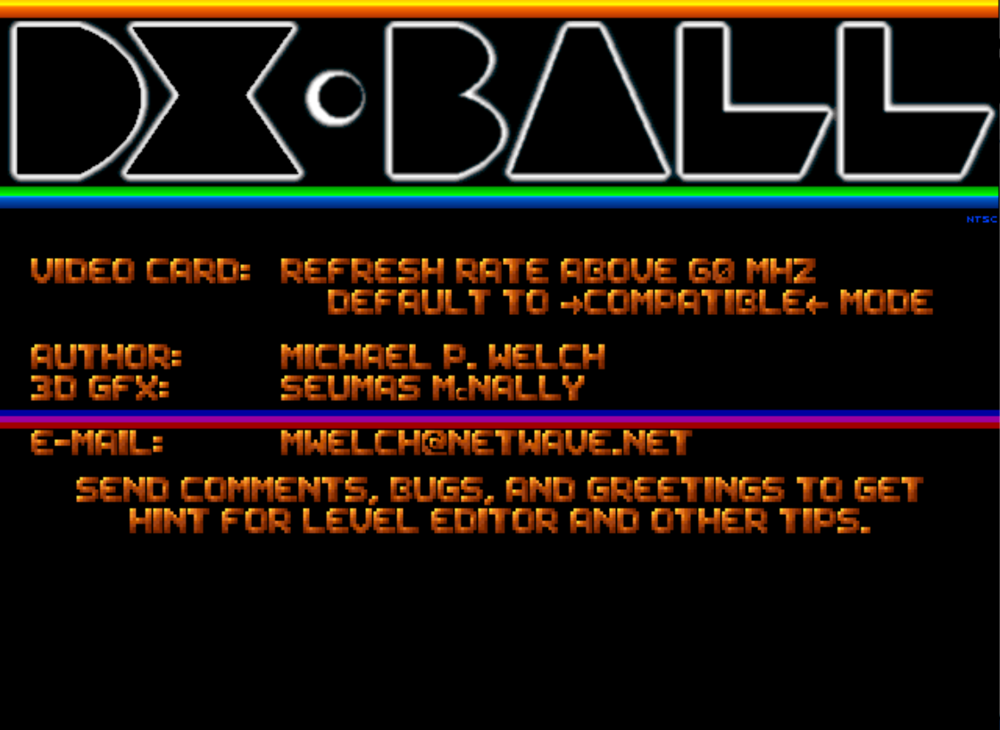
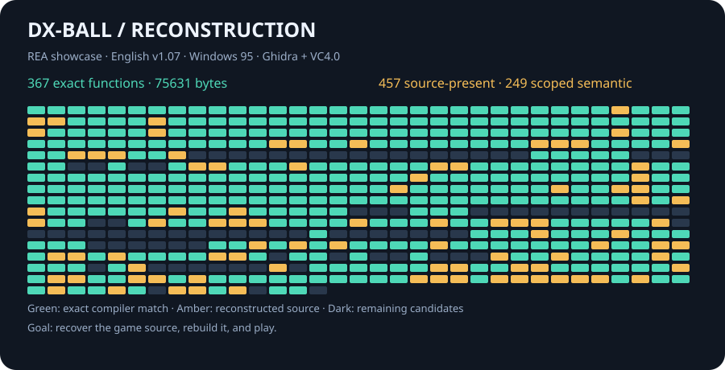

# DX-Ball reconstruction

**Status:** Exact reconstruction is in progress. We'll finish that first,
then get the game building and playable with the original Visual C++ 4.0
compiler. Platform ports will resume after that.

<p align="center">
  
</p>

This project reconstructs English DX-Ball v1.07 as readable C/C++ that can be
compiled into a working game. Codex uses [REA](https://github.com/morluto/rea)
to inspect the original executable through Ghidra, recover its functions, and
refine the source by comparing compiled code with the original.

## Reconstruction with REA

REA gives Codex access to Ghidra's pseudocode, instructions, calls, and data
references. The reconstruction proceeds function by function:

1. **Inspect a function with REA.** Read its pseudocode and instructions,
   then follow calls and data references to understand its logic and field layouts.
2. **Recover the source.** Express that logic in typed C/C++ and connect it
   to the rest of the game.
3. **Compile and compare.** Build with Visual C++ 4.0 and compare the whole
   function with the original. Use each difference to decide what to inspect
   or change next. A focused behavior check can resolve questions left by
   the code comparison.

A byte-exact match means the entire function's machine code agrees after
mapping addresses for calls and data. The original and rebuilt programs place
functions and globals at different addresses, so those references need an
explicit mapping. The remaining bytes help resolve argument widths, branch
conditions, and the order of state changes that pseudocode alone can miss.

Saved REA responses link source decisions to the executable. The
[worked example](docs/REA.md) follows a projectile-list routine from analysis
to source and a complete compiler match.

## Try the workflow with Codex

These steps set up a Linux x86-64 workspace and let Codex continue the
reconstruction from the source and research in this repository. You will need:

- Git and Python 3.11+ with pip.
- Node.js 22.19.0 with npm. Use the official Linux x64 binary; the project
  checks the Node executable's hash as well as its version.
- Wine with 32-bit support, Xvfb with `xvfb-run`, `unzip`, and `tar`.
  Wine runs the original-era Windows compiler on Linux.
- CMake, Ninja, and GCC or Clang to build the portable source.

The setup scripts below download the JDK, Ghidra, and Visual C++ 4.0 compiler.

If you need the matching Node version, download
[`node-v22.19.0-linux-x64.tar.gz`](https://nodejs.org/download/release/v22.19.0/node-v22.19.0-linux-x64.tar.gz)
and extract it into a directory you own. For example, with the archive in
your Downloads directory:

```bash
mkdir -p "$HOME/.local/opt"
tar -xzf "$HOME/Downloads/node-v22.19.0-linux-x64.tar.gz" -C "$HOME/.local/opt"
export PATH="$HOME/.local/opt/node-v22.19.0-linux-x64/bin:$PATH"
node --version
npm --version
```

`node --version` should print `v22.19.0`. Keep using this terminal for the
remaining steps. Add the `export PATH` line to your shell configuration if
you want it available in future terminals.

### 1. Get the game and prepare the workspace

Download the English Windows archive from
[DX-Ball on Old Games Download](https://oldgamesdownload.com/game/dx-ball-m3r/).
Choose `DX_Ball_Win_Preinstalled_EN.zip` under **Windows (1996)**.
The [original English readme](https://oldgamesdownload.com/readme/dx-ball-windows-readme-english/)
identifies version 1.07 and describes the game and its controls. Keep the ZIP
intact; the importer extracts the executable and assets together.

Fork [this repository](https://github.com/N0zoM1z0/dx-ball) on GitHub so Codex
can push its work to your copy. Replace `YOUR_GITHUB_USERNAME` with your
username. Configure Git authentication for your fork before starting Codex:

```bash
git clone https://github.com/YOUR_GITHUB_USERNAME/dx-ball.git
cd dx-ball
scripts/bootstrap-python.sh
scripts/repo-python scripts/import-target.py /absolute/path/to/DX_Ball_Win_Preinstalled_EN.zip
```

Replace the archive path with your download. The importer verifies the ZIP
and game files against [the target configuration](config/target.toml), then
puts `DXBALL.EXE` and the assets in `original/`. It reports the number of
verified and imported files. This directory is excluded from Git.

### 2. Install REA and connect it to Codex

Install or update Codex and REA. The `/goal` workflow used below requires
Codex 0.128.0 or newer:

```bash
npm install --global @openai/codex@latest rea-agents@latest
codex --version
rea --version
```

From the repository root, install the project's compiler and analysis tools:

```bash
scripts/repo-python scripts/bootstrap-tools.py
scripts/repo-python scripts/bootstrap-rea.py
```

The first command installs the JDK and Visual C++ 4.0 compiler. The second
installs REA and Ghidra from [the project's lock file](config/rea.lock.json),
currently REA 6.5.0 and Ghidra 12.1.4. Both scripts verify their downloads
and keep the tools in `.tools/`. The global REA CLI configures Codex;
the project's `scripts/rea` command uses the locked tools for analysis.

Point REA at the installed Ghidra and JDK, then connect it to Codex:

```bash
export GHIDRA_INSTALL_DIR="$(pwd)/.tools/ghidra-rea"
export JAVA_HOME="$(pwd)/.tools/jdk"
rea setup --client codex
rea doctor --client codex --provider ghidra --json
```

Review and accept the changes shown by setup. It registers the REA MCP
server, saves the Ghidra and JDK paths, and installs the REA skill that guides
Codex's analysis. The doctor command checks the connection and provider;
look for `healthy: true`. A failed check includes instructions for fixing it.

The [REA setup guide](https://github.com/morluto/rea/blob/main/docs/installation.md)
also covers using an existing Ghidra installation. To update an existing
integration, repeat the global installation and setup commands, then restart
Codex. Project analysis follows [the REA instructions](docs/agent/REA.md).

### 3. Start Codex in the repository

From the same terminal, run:

```bash
codex
```

Sign in when prompted; the [Codex CLI guide](https://developers.openai.com/codex/cli/)
explains the authentication options. In Codex, enter `/mcp` to check that
REA is connected. If Codex was open during REA setup, restart it to load
the new registration.

Starting from the repository root gives Codex access to `AGENTS.md`, the
original executable, recovered source, and research notes. The repository's
instructions tell it which toolchain to use and where to resume recovery.

### 4. Give Codex a reconstruction goal

A [Codex Goal](https://developers.openai.com/cookbook/examples/codex/using_goals_in_codex)
lets Codex continue working toward an outcome across turns. Paste the
following English prompt into Codex. It starts with function recovery,
then moves to full game validation, and publishes verified checkpoints
to your fork:

```text
/goal Reconstruct English DX-Ball v1.07 from original/DXBALL.EXE as readable,
rebuildable C/C++. First recover every game-authored function as faithfully as
possible and maximize complete byte-exact matches with Visual C++ 4.0. Once
function recovery is complete, validate the rebuilt game's full behavior.

Read AGENTS.md, docs/agent/HANDOFF.md, and docs/agent/WORKFLOW.md. Continue from
the handoff, using REA to inspect unresolved functions and their callers,
callees, and data. Reuse saved evidence and recover related functions together.

Write typed source shared by the portable and legacy builds, preserving the
original calling conventions, integer widths, ownership, and state changes.
Recover the implementation from the evidence; avoid copied machine code,
assembly replacements, or padding added to force a match.
Compile each stable batch and compare whole functions with explicit mappings
for address references. Fix the differences and recheck affected exact matches.
Use focused checks to answer recovery questions along the way.

Record verified results in the match ledgers, progress, and handoff. Keep code
and documentation in English. Follow the project's resource limits and clean
disposable build products after preserving unique evidence. Commit verified
checkpoints with the prefix "gpt-6.1-sol: " and push to origin/main.

Report progress through recovered functions and exact matches. For remaining
mismatches, give the function addresses, comparison results, and next steps.
```

Use ordinary follow-up messages in the same thread to adjust priorities.
Enter `/goal` to view the objective, `/goal pause` to pause work, and
`/goal resume` to continue. Follow the results through the
[matching guide](docs/MATCHING.md) and [source map](src/README.md).

If you also want to collect REA feedback, add this optional instruction.
Keeping it in one file makes it easy to review without interrupting recovery:

```text
Append useful REA feedback to /tmp/dxball-rea-feedback.md. Note slow calls,
oversized responses, token and context costs, and usability improvements,
with a concrete example when available. Keep this optional and brief;
function reconstruction remains the priority. Reuse the same document.
```

## Progress

<p align="center">
  
</p>

The diagram tracks recovered functions and exact compiler matches. See the
[progress records](docs/PROGRESS.md) for current counts and the
[research notes](docs/research/README.md) for the recovered game flows.

## Build and explore

- [Build and play](docs/BUILD.md) — supply the original files, compile, and launch.
- [Source map](src/README.md) — find the modules behind each part of the game.
- [Architecture](docs/ARCHITECTURE.md) — follow startup, mode dispatch, and a frame.

DX-Ball was created by Michael P. Welch, with 3D graphics by Seumas McNally.
Original game files are supplied separately. See [LICENSE](LICENSE).
