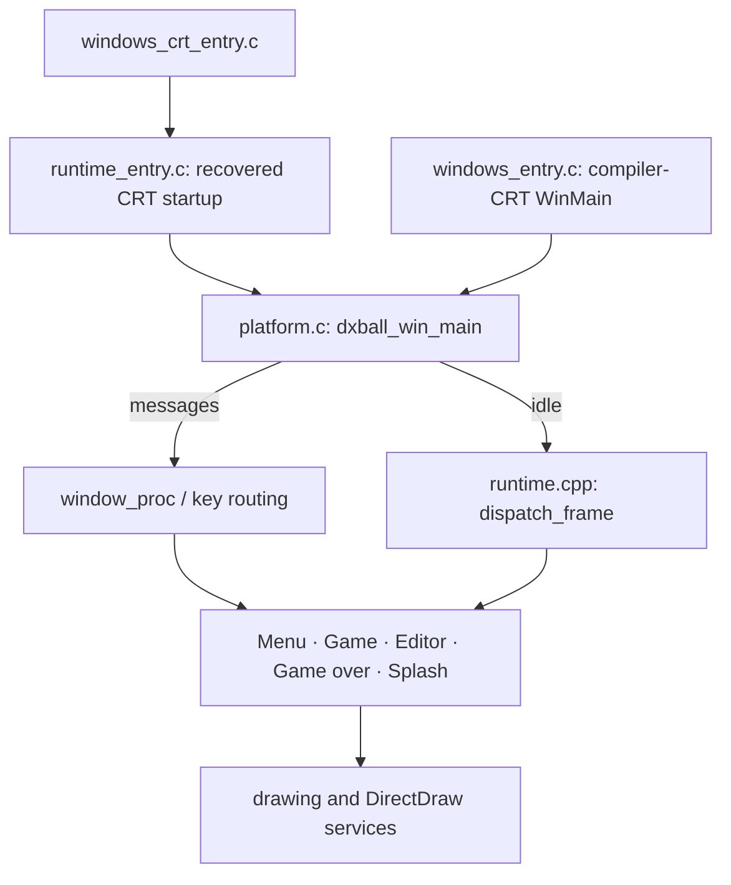

# How the game fits together

Follow [platform.c](../src/platform.c) → [runtime.cpp](../src/runtime.cpp) →
[core.c](../src/core.c) for the message loop, mode dispatch and a gameplay frame.
The [source map](../src/README.md) lists supporting owners.

## Entry and modes

The current restored-CRT executable starts in
[windows_crt_entry.c](../src/windows_crt_entry.c), binds Windows services, then
runs [runtime_entry.c](../src/runtime_entry.c). That startup initializes the
heap, low-level I/O, arguments, environment and C/C++ initializers before
calling `dxball_win_main` in `platform.c`.

Compiler-CRT builds enter through [windows_entry.c](../src/windows_entry.c).
Both paths reach the same game loop: process queued window messages, then call
`dxball_dispatch_frame` while active and idle. The window procedure records
mouse state and routes keys to the selected mode.

`runtime.cpp` coordinates mode initialization, redraw, frame work and cleanup.
It processes device reset before dispatch and cleans up the old mode when the
selected mode changes.

| Mode | Main code |
| --- | --- |
| 0 — Menu | [intro.cpp](../src/intro.cpp): menu and point animation |
| 1 — Game | [core.c](../src/core.c): frame; [runtime.cpp](../src/runtime.cpp): lifecycle and score |
| 2 — Editor | [editor.c](../src/editor.c): toolbar, painting and bank persistence |
| 3 — Game over | [gameover.c](../src/gameover.c): name entry and rankings |
| 4 — Splash | [intro.cpp](../src/intro.cpp): credits and scroller |

## A gameplay frame

`dxball_game_frame` refreshes the score and updates the paddle, balls,
projectiles, bonuses and particles. It restores dirty regions, advances brick
and fire effects, draws moving objects, presents the back buffer and advances
palette animation. It then handles explosion requests, collected bonuses,
level/life transitions and launch/firing input.

[gameplay.c](../src/gameplay.c) owns brick-hit rules;
[effects.c](../src/effects.c) advances animations;
[bonuses.cpp](../src/bonuses.cpp) and [particles.c](../src/particles.c) own their
entities. [balls.cpp](../src/balls.cpp) handles creation, cloning and rebounds,
while `core.c` handles movement and collisions. [round.c](../src/round.c) drives
level/life progression and [round_reset.cpp](../src/round_reset.cpp) resets a
board. [paddle_render.cpp](../src/paddle_render.cpp) draws the paddle;
[last_brick.cpp](../src/last_brick.cpp) controls last-brick lightning.

## State and drawing

Headers expose shared state and call contracts. [list_initializers.cpp](../src/list_initializers.cpp)
owns global entity lists. [board_storage.h](../src/board_storage.h) keeps the
board bank, palette clock, explosion list, ball count and working tiles in one
storage object. [boards.c](../src/boards.c) loads and draws the 20×20 boards.
Game integers retain 32-bit widths; pointers and OS/surface handles follow the
host ABI.

[resources.cpp](../src/resources.cpp) owns shared bank state and PCX decoding.
Sprite-bank loading, selection, capture, drawing and release have individual
compiler-owner files listed in the source map. [glyphs.cpp](../src/glyphs.cpp)
handles glyph lookup/drawing; [ui.c](../src/ui.c) handles text layout and palette
operations. [drawing_primitives.cpp](../src/drawing_primitives.cpp) draws lines
and rectangles. [display.cpp](../src/display.cpp) manages dirty regions and
presentation; [device.cpp](../src/device.cpp) manages fades and surface recovery.

[rotation.cpp](../src/rotation.cpp), [raster.cpp](../src/raster.cpp),
[fill_polygon.cpp](../src/fill_polygon.cpp) and [bitmap.c](../src/bitmap.c)
provide software image and raster operations. [clock.cpp](../src/clock.cpp) and
[frame_wait.cpp](../src/frame_wait.cpp) provide timing utilities.

## Platform services and builds

[windows_adapter.c](../src/windows_adapter.c) binds Win32, DirectDraw,
DirectSound and WinMM. [sound.c](../src/sound.c) manages WAV/buffer playback;
[midi.cpp](../src/midi.cpp) parses and streams MDS music;
[music.cpp](../src/music.cpp) owns song lifetime and controls. Typed service
pointers and `*Ops`/`*Api` tables let native tools supply controlled dependencies.

[CMakeLists.txt](../CMakeLists.txt) builds the portable core, inspectors and
MinGW game. The legacy builder also links recovered `runtime_*` CRT owners for
the restored-CRT game. [allocator_host.c](../src/allocator_host.c) supplies
portable heap callbacks; [runtime_text_host.c](../src/runtime_text_host.c)
supplies Unix score conversion. The [build guide](BUILD.md) describes each profile.
