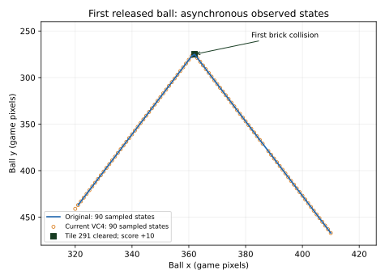

# Current first released ball

The original executable and current VC4 game agree on 89 complete sampled ball
vectors, in the same order, during the first released ball's flight. Both clear
the same brick, gain ten points, miss the paddle after actual mouse input moves
it away, lose one life, initialize a fresh attached ball and exit normally.
This extends the current menu and paused-frame evidence into moving gameplay.

The figure connects observed original positions and marks observed VC4
positions. It does not interpolate additional observations or synchronize
the two processes' clocks.

## Actual input and read-only observation

Real opening and play input initializes one attached ball at x320/y441, angle
75 and speed five. A real mouse press releases it; button-up and mouse motion
move the paddle to the right, away from the returning ball. The persistent SDK
reader samples through the first life loss. Existing one-shot observations
confirm the next attached ball and menu/zero-exit path.

The campaign reader already reads thirteen signed 32-bit ball fields. It now
emits all of them, alongside the existing sprite dimensions. Its target rights,
52-byte ball read, list traversal and sprite lookups are unchanged. Full initial
ball values independently agree with the existing one-shot reader in both
processes. One strict C90 helper compilation records all 108 actually consumed
recursive include dependencies. The game needs no rebuild.

Complete raw JSONL streams and exact byte-offset/receipt-time indexes are retained:
669 original records and 659 current VC4 records, zero malformed records, both
reader and game exit codes zero. Windows CRLF bytes remain part of the raw
carriers; the offline comparison validates every indexed byte extent.

## Compared states and effects

Each first-flight interval contains 90 distinct sampled ball vectors. Eighty-nine
match all thirteen ball fields and both sprite dimensions in the same order.
The two remaining observations are kept explicitly:

- VC4 samples the released ball at x320/y441 before its first displacement;
  the original's first released sample has already moved to x321/y437.
- Only the original samples the complete x387/y375 vector. The observed VC4
  successor at x388/y379 names x387/y375 as its predecessor coordinates.
  That predecessor reference does not replace the unsampled complete vector.

| Observed effect | Original and current VC4 |
| --- | --- |
| Initial complete 400-byte board | Original `DEFAULT.BDS` board zero |
| Only board change | Tile index 291: 11 to 0 |
| Collision ball position | x362/y275 |
| Collision velocity and count | dx1/dy4, bounce count 1 |
| Score | 0 to 10 |
| First missed ball | Lives 3 to 2; empty ball list observed |
| Resulting complete board | Equal 400-byte states |
| Shutdown | Fresh attached ball, menu, exit code zero |

This is exact agreement of sampled vectors and complete board effects. Sequential
field reads are not an atomic simulation snapshot, and the requested ten-ms
reader sleep does not prove every simulation frame was observed. Clock parity,
later paddle reflections, other ball parameters, a full campaign and physical
display/audio/MIDI remain open. No new function or exact-byte acceptance follows
from this observation.

## Evidence and retained products

Current VC4 executable SHA-256:
`0302cf38a82c7d9843af135e2c054b26d2dd5c7f1d12d53199f1b1584c3a4b28`.
All four PCX-checkpoint products and all 49 originals remain unchanged.
The temporary runtime copies are removed after identity checks; full raw
streams, SDK binary/compile identities, state records and derivation remain.

REA 6.4 controlled-replay Evidence:
`ev_004437a523c46dcf6514bb61fe88d62e789f3b0ff8502264e4b493dbb4027735`.
The child exits zero and the recorder's filesystem checkpoint hashes the
complete runtime report. Process sampling reaches its 64-sample cap and remains
explicitly partial, with the recorder's non-atomic executable-binding limit.
Those process limits are separate from the complete retained SDK stream bytes.

Private proof: `.analysis/first-ball-flight/report.json`, `comparison.json`,
`evidence.json`, `reader-identity.json` and both profile directories.
The raw streams total 1,479,558 bytes, preserved without a second archive copy.
Performance and usability feedback continues only in
`/tmp/dxball_rea_feedback_20261010.md`.
